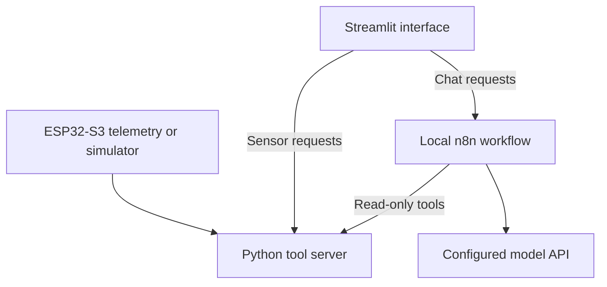

# AYUSARTHI (AYU AI)

A local hackathon prototype that combines room sensor monitoring, a Streamlit chat interface, and an n8n model workflow.

**Status:** prototype. The Python sensor simulator and backend can run without a model API. AI chat requires a separately configured n8n workflow. The sensors measure room conditions and distance; they do not diagnose illness or detect a confirmed fall.

## What is implemented

| Component | Current behavior |
|---|---|
| Sensor monitor | Reads serial JSON or labelled demo values; withholds stale readings |
| Local API | Serves sensor status, a synthetic profile, educational notes, and event history |
| LED rules | Calculates a software LED decision from darkness, posture estimate, and freshness |
| Frontend | Chat, manually refreshed monitoring, and optional voice input/output |
| Health-note retrieval | Keyword search over three source-linked educational summaries |
| Caregiver and alerts pages | Placeholder screens; no accounts, notifications, or emergency calls |

The Python LED decision does not drive a physical LED: no serial command or acknowledgement path is implemented. Real posture estimates remain unknown until the installation is calibrated. Conversation memory depends on the n8n workflow; a session ID alone does not provide it.

## Data flow



See [architecture](docs/ARCHITECTURE.md) for the state and control boundaries.

## Run locally

Use Python 3.12 for the configuration checked by the repository tests. From the repository root on Windows:

```bat
py -m venv .venv
.venv\Scripts\activate.bat
python -m pip install -r requirements.txt -c constraints-demo.txt
python -m backend.tool_server --demo
```

On macOS/Linux, create the environment with `python3 -m venv .venv` and activate it with `source .venv/bin/activate`.

Open another terminal, activate the same environment, and run:

```bat
python -m streamlit run streamlit_app.py --server.address 127.0.0.1
```

Open the local URL printed by Streamlit. Monitoring works with the backend alone; chat reports a connection error until n8n is configured. [n8n setup](automation/n8n/README.md) describes the request, response, and tool contracts.

The frontend reads `N8N_CHAT_URL` and `SENSOR_URL` from the process environment. Their defaults are shown in [.env.example](.env.example). The application does not load a `.env` file automatically.

For example, in Windows Command Prompt before starting Streamlit:

```bat
set N8N_CHAT_URL=http://localhost:5678/webhook/ayusarthi-chat
set SENSOR_URL=http://127.0.0.1:8000/tools/sensor-status
```

Keep these services local. See [security boundaries](SECURITY.md).

### Optional voice and hardware

The default install supports typed chat and sensor monitoring. Install optional audio dependencies separately with `python -m pip install -r requirements-voice.txt`. Optional voice dependencies are not covered by the demo constraints or CI.

The frontend uses local Whisper transcription after its first model download. It requires an FFmpeg executable on `PATH`; confirm the transcript before sending it to chat. Typed chat does not require FFmpeg.

Backend speech is enabled with `--speak`. The frontend has its own **Spoken replies** toggle. Both depend on the computer's audio setup.

For actual serial telemetry, replace `--demo` with `--serial COM5` using the correct port. [Hardware notes](hardware/esp32-s3/README.md) contain the recorded pin map and telemetry format. Only a telemetry helper is included, not a complete firmware sketch.

## Repository layout

| Path | Purpose |
|---|---|
| `streamlit_app.py`, `frontend/` | Frontend entrypoint, UI, and logo |
| `backend/` | HTTP tools, monitoring, event rules, and voice helpers |
| `backend/data/` | Synthetic fixtures and calibration configuration |
| `automation/n8n/`, `prompts/` | Workflow setup contract and agent instructions |
| `hardware/esp32-s3/` | Hardware notes and serial telemetry helper |
| `tests/` | Local backend, frontend-contract, and repository checks |
| `judge_submission/` | Standalone review copy of the application |

The root application is the development source. The judge copy is generated from an explicit file list and checked by CI. See [development and demo checks](docs/DEVELOPMENT.md).

## Checks and limitations

```bat
python -m unittest discover -s tests -v
```

CI checks Python 3.12 on Linux and Windows, builds the judge archive, runs a simulated backend check, and audits the tested dependencies. Download the archive and check results from the workflow run artifacts.

The tests use temporary files, local HTTP servers, and mocked frontend requests. They do not establish hardware accuracy, model-answer quality, audible speech, or end-to-end n8n behavior.

There is no workflow export, complete firmware, measured accuracy report, or recorded end-to-end demo in this repository. The educational notes are source-linked fixtures, not a clinical knowledge base. No license has been selected.

The next useful milestone is a repeatable end-to-end demo with a sanitized n8n workflow export, followed by measured hardware calibration. The included backend check does not verify those missing integrations.
